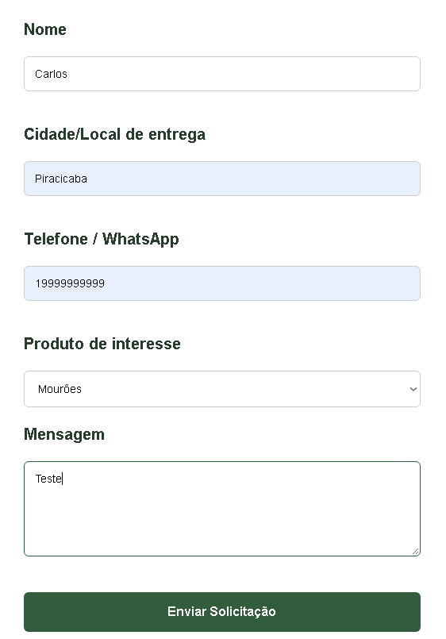
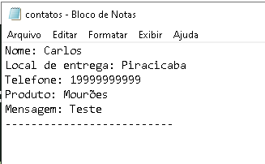

# JMV Eucaliptos Tratados

O site foi desenvolvido para a empresa "JMV Eucaliptos Tratados", com o objetivo de apresentar mais sobre a empresa e seus produtos.

## Integrantes do Grupo

- **Augusto Martins da Cruz**
- **Carlos Eduardo Ferreira de Paula**
- **Guilherme Mathias**
- **Leonardo Elias Fernandes**
- **Vitor Breviglieri dos Santos**

## Tecnologias Utilizadas

- HTML: Estruturação semântica das seções da página;
- CSS: Estilização completa, layout responsivo com Flexbox e CSS Grid, cabeçalho fixo e destaque automático do menu ativo durante a - rolagem;
- PHP: Processamento back-end do formulário de solicitação de orçamento e armazenamento dos registros em arquivo de texto;

## Requisitos e Dependências

Para executar o projeto localmente com o funcionamento completo, é necessário:

**Servidor Web com suporte a PHP** (versão 7.4 ou superior), como **XAMPP**, **WAMP**, **Laragon** ou servidor embutido do PHP;
**Navegador Web atualizado** (Google Chrome ou Microsoft Edge recomendados para suporte completo à animação de rolagem via CSS;
Permissão de escrita na pasta raiz do projeto para criação/atualização automática do arquivo.

## Instalação e Execução

1. Baixe ou clone este repositório na pasta pública do seu servidor local (ex: `C:\xampp\htdocs\jmv-eucaliptos`).
2. Abra o painel do servidor (XAMPP/WAMP) e inicie o módulo **Apache**.
3. Acesse o projeto pelo navegador através do endereço: `http://localhost/jmv-eucaliptos/index.php`.

## Principais Funcionalidades

1. Menu superior fixo que acompanha a rolagem da tela e destaca automaticamente a seção em visualização;
2. Exibição detalhada dos principais itens comercializados;
3. Apresentação dos benefícios do eucalipto tratado;
4. História, valores e diferenciais da empresa, com links diretos para Instagram e Facebook;
5. Validação de campos obrigatórios e gravação automática das solicitações enviadas pelos clientes no arquivo.

## Imagens e Exemplos de Funcionamento

1. Preenchimento do Formulário de Orçamento

2. Registro Salvo Automaticamente no `contatos.txt` (Back-end PHP)
